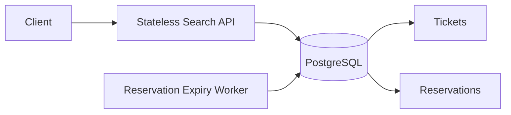
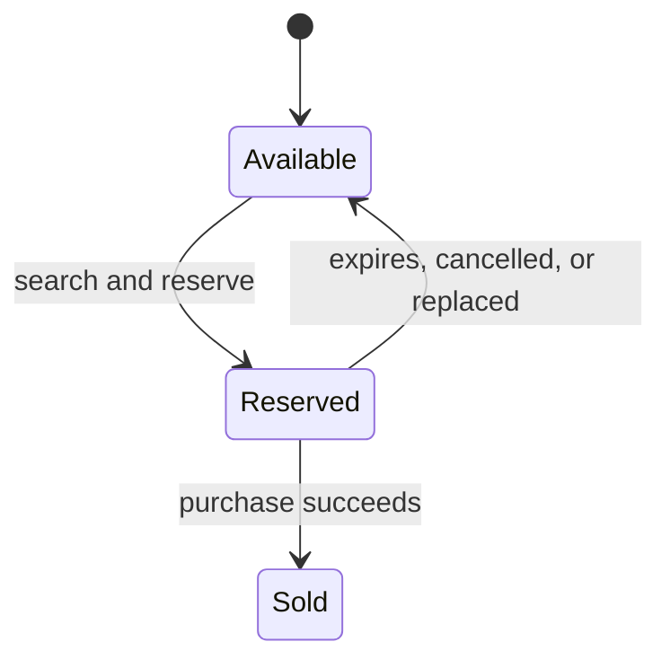

# Lottery Ticket Search System

## 1. Overview

This document proposes a production-oriented design for searching and allocating more than 10 million lottery tickets. A search pattern is exactly six characters; each character is either a digit or `*`, where `*` matches one digit.

The initial design uses PostgreSQL only. PostgreSQL is both the system of record and the concurrency authority, which keeps the design operationally simple and lets ticket allocation use database transactions and row-level locks.

The system performs a **search-and-reserve** operation. Tickets are reserved before they are returned, because the brief requires concurrent searches not to return the same ticket to multiple users.

## 2. Assumptions

- A ticket belongs to one draw and is identified by `draw_id + number + set_no`.
- `number` is always a six-digit string, including leading zeros such as `000023`.
- A search is scoped to one draw.
- A search returns 10 tickets by default and at most 20.
- Returned tickets are held for five minutes.
- A user may have only one active search reservation. Replacing it must be explicit.
- A failed replacement leaves the previous reservation unchanged.
- Duplicate allocation is prevented across all patterns, not only identical patterns.
- No throughput or latency is claimed without a production-like benchmark.
- Based on the candidate's experience with Thai lottery purchasing behavior, two-digit and three-digit suffix searches are expected to be common. Dedicated suffix indexes are included as an experience-based optimization, while generic wildcard search remains supported. This assumption must be verified using production metrics.

## 3. Architecture



- **Search API:** validates patterns, chooses a search strategy, and performs atomic reservation.
- **PostgreSQL:** stores tickets and reservations and prevents duplicate allocation.
- **Expiry worker:** releases reservations whose five-minute hold has expired. Its operations are idempotent.
- **API instances:** are stateless and can be scaled horizontally behind a load balancer.

## 4. Data Model and Indexes

### Tickets

```text
tickets
  id              bigint primary key
  draw_id         bigint not null
  number          char(6) not null
  set_no          integer not null
  status          available | reserved | sold
  reservation_id  nullable foreign key
  created_at      timestamp
```

Important constraints and indexes (illustrative SQL):

```sql
CHECK (number ~ '^[0-9]{6}$');
UNIQUE (draw_id, number, set_no);

CREATE INDEX tickets_available_number_idx
ON tickets (draw_id, number, id)
WHERE status = 'available';

CREATE INDEX tickets_available_last2_idx
ON tickets (draw_id, RIGHT(number, 2), id)
WHERE status = 'available';

CREATE INDEX tickets_available_last3_idx
ON tickets (draw_id, RIGHT(number, 3), id)
WHERE status = 'available';

CREATE INDEX tickets_reserved_reservation_idx
ON tickets (reservation_id)
WHERE status = 'reserved';
```

The suffix indexes optimize the expected common paths. They add storage and write amplification, so production metrics should determine whether they remain worthwhile.

### Reservations

```text
reservations
  id               uuid primary key
  user_id          string not null
  status           active | purchased | expired | replaced | cancelled
  expires_at       timestamp not null
  idempotency_key  string not null
  created_at       timestamp
```

```sql
CREATE UNIQUE INDEX reservations_one_active_per_user_idx
ON reservations (user_id)
WHERE status = 'active';

CREATE UNIQUE INDEX reservations_idempotency_idx
ON reservations (user_id, idempotency_key);

CREATE INDEX reservations_expiry_idx
ON reservations (expires_at)
WHERE status = 'active';
```

The unique active-reservation index prevents concurrent requests from giving one user more than the configured hold limit. The idempotency index makes request retries return the existing result instead of allocating again.

## 5. Search Algorithm

### Validation

A valid pattern contains exactly six characters and only digits or `*`. Exact numbers and `******` are valid.

### Strategy selection

| Pattern shape | Example | Search strategy |
| --- | --- | --- |
| Exact number | `123456` | Exact indexed lookup |
| Two-digit suffix | `****23` | Dedicated `RIGHT(number, 2)` index |
| Three-digit suffix | `***123` | Dedicated `RIGHT(number, 3)` index |
| All wildcards | `******` | Available-ticket index with a result limit |
| Other wildcard layouts | `1****5`, `1*2*3*` | Lazy candidate expansion |

### Generic wildcard expansion

For a pattern with `k` wildcards, there are `10^k` possible numbers. The API does not create and shuffle the complete list. Instead, it:

1. Derives a deterministic pseudo-random start and step from the pattern and idempotency key.
2. Generates candidates lazily in non-repeating batches of 200.
3. Queries exact numbers with `number = ANY($batch)`.
4. Stops when the requested result count is reached.
5. Tries at most three exact-lookup batches before using the controlled fallback for any remaining slots.

For example, `1234*5` has only ten candidates: `123405`, `123415`, ... `123495`. For `1****5`, the API generates only the batches it needs rather than materializing all 10,000 possibilities.

Every candidate preserves the fixed digits in the original pattern. The SQL may also apply the translated `LIKE` pattern as a defensive check after the exact candidate filter.

### Controlled fallback

After at most three batches, if fewer tickets than requested have been reserved, the API may run one direct `LIKE` query to fill the remaining slots. For example, `****23` becomes `LIKE '____23'`.

Leading-wildcard `LIKE` queries may scan many available tickets, so fallback is protected by:

- a statement timeout;
- global and per-pattern concurrency limits;
- rate limiting and a circuit breaker;
- metrics for fallback rate, duration, and rows scanned.

An empty or timed-out fallback is not automatically reported as sold out. Rows may be temporarily locked by other transactions. The API may return a partial result or a retryable response.

## 6. Atomic Allocation and Reservation

Each candidate query selects and reserves tickets atomically. Illustrative SQL:

```sql
WITH picked AS (
    SELECT t.id
    FROM tickets AS t
    WHERE t.draw_id = $1
      AND t.status = 'available'
      AND t.number = ANY($2::char(6)[])
    FOR UPDATE SKIP LOCKED
    LIMIT $3
)
UPDATE tickets AS t
SET status = 'reserved', reservation_id = $4
FROM picked
WHERE t.id = picked.id
RETURNING t.id, t.number, t.set_no;
```

`FOR UPDATE SKIP LOCKED` ensures that concurrent requests skip tickets currently being allocated instead of waiting for or duplicating them. Because locking is on ticket rows, different patterns that happen to match the same ticket are also safe.

For replacement, one short transaction:

1. Locks the user's active reservation.
2. Builds the replacement reservation using the same reservation ID across batches.
3. If at least one new ticket is found, marks the old reservation as replaced and releases its tickets.
4. Activates the new reservation and commits.
5. If allocation fails, rolls back so the old reservation remains unchanged.

Purchase is an atomic conditional update. It must verify the reservation ID, user ID, active status, and `expires_at > CURRENT_TIMESTAMP`. This prevents purchasing an expired hold before the expiry worker has processed it.

## 7. Reservation Lifecycle



The application never keeps a database transaction open while the user decides. The reservation is committed immediately with an expiry time. The worker later releases expired tickets with a conditional, idempotent update. If the worker is delayed, tickets remain unavailable longer, but they are not allocated twice.

## 8. Performance and Trade-offs

### Normal path

- Exact and suffix searches use partial indexes containing only available tickets.
- Generic search sends at most 200 exact candidate numbers per batch.
- At most 20 ticket rows are reserved per search.
- Transactions are short and touch only selected ticket and reservation rows.
- Randomized candidate traversal reduces, but does not eliminate, contention for hot patterns.

### Costs and worst cases

- Every reservation changes ticket status, producing index updates, WAL, and dead tuples. Autovacuum must be monitored and tuned.
- The suffix indexes improve expected common searches but add further write amplification.
- `******`, highly popular patterns, and near-sell-out inventory create the most contention.
- The fallback may scan a large part of the available inventory and must remain a controlled exceptional path.
- `SKIP LOCKED` favors throughput over a perfectly fair ordering of tickets.

No requests-per-second or latency figure is promised. Capacity must be measured with 10M production-like rows, realistic availability ratios, hot patterns, concurrent replacement requests, and near-sell-out scenarios. Measurements should include throughput, p50/p95/p99 latency, lock conflicts, empty batches, fallback rate, rows scanned, WAL volume, and autovacuum pressure.

## 9. Scaling and Operations

The initial deployment uses PostgreSQL primary/standby, connection pooling, and multiple stateless API instances. Tickets can be partitioned by draw for lifecycle management and partition pruning, although partitioning does not increase throughput when all traffic targets one draw.

Read replicas may serve non-reserving reporting queries, but allocation must use the primary. If measurement later shows candidate search—not reservation writes—to be the bottleneck, a Redis bitmap may be introduced as a disposable search accelerator. PostgreSQL remains the authority for reservation and purchase.

Operational monitoring should cover database saturation, lock waits, fallback activity, reservation expiry lag, allocation failures, and the distribution of pattern shapes. The last metric validates whether the experience-based suffix indexes are justified.

## 10. Alternatives Considered

- **Plain `LIKE` for every search:** simple but unpredictable for leading and internal wildcards and expensive when no match remains.
- **Store all wildcard forms:** up to 64 forms per ticket, or roughly 640 million index entries for 10 million tickets.
- **Redis as the primary allocator:** fast search, but introduces cross-system consistency and durability concerns. It is better used later as a rebuildable accelerator.
- **Elasticsearch-style search engine:** flexible search but adds operational complexity and still requires a transactional authority for allocation.

## 11. Requirements Coverage

| Requirement | Design response |
| --- | --- |
| 10M+ six-digit tickets | Draw-scoped PostgreSQL table with validated six-digit values and indexed access |
| Six-character wildcard patterns | Validation, specialized suffix paths, and generic lazy expansion |
| No duplicate simultaneous result | Atomic reservation with row locks, `SKIP LOCKED`, reservation state, and expiry |
| Efficient querying and allocation | Partial indexes, bounded candidate batches, short transactions, and controlled fallback |
| Production database recommendation | PostgreSQL, justified by transactions, locking, indexing, and operational simplicity |
| Performance analysis | Normal-path costs, worst cases, trade-offs, metrics, and a benchmark plan without unverified claims |
| Real-world practicality | Idempotency, explicit replacement, expiry recovery, scaling path, and observability |
